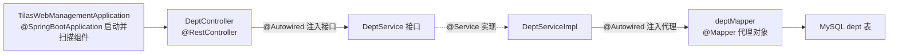

# 项目笔记：每个文件的注解一句话讲解 + 调用关系

> 范围：tilas-web-management（部门管理）当前代码 ｜ 配套阅读：《项目笔记-SpringBoot分层框架.md》

## 一、每个文件的注解一句话讲解

### 1. TilasWebManagementApplication.java（启动类）

| 注解 | 加在哪 | 一句话讲解 |
|------|--------|-----------|
| `@SpringBootApplication` | 类 | = 配置类 + 开启自动配置 + 扫描 `com.qza` 包下所有组件，一个注解顶三个 |

`main` 里一句 `SpringApplication.run(...)` 启动内嵌 Tomcat，整个应用跑起来。

### 2. DeptController.java（控制层）

| 注解 | 加在哪 | 一句话讲解 |
|------|--------|-----------|
| `@RestController` | 类 | = `@Controller` + `@ResponseBody`，方法返回值直接序列化成 JSON 写回浏览器 |
| `@Autowired` | 字段 `deptService` | 让 Spring 按类型注入 Bean，运行时拿到的是 `DeptServiceImpl` 实例 |
| `@RequestMapping(value="/depts", method=GET)` | 方法 `list()` | 把 GET `/depts` 请求映射到该方法（老写法） |
| `@DeleteMapping("/depts/{id}")` | 方法 `delete()` | 只接 DELETE `/depts/xxx` 请求，`{id}` 是路径占位符（新写法） |
| `@PathVariable` | 形参 `id` | 把路径里 `{id}` 占位的值取出来装进形参，自动转类型 |

### 3. DeptService.java（业务接口）

- **没有任何注解**：纯接口，只定义业务契约 `findAll()`，规定"做什么"不写"怎么做"。
- 小瑕疵：import 了 `org.apache.ibatis.annotations.Select` 但没用到，可删。

### 4. DeptServiceImpl.java（业务实现）

| 注解 | 加在哪 | 一句话讲解 |
|------|--------|-----------|
| `@Service` | 类 | 把实现类注册进 Spring 容器当 Bean；漏加则 Controller 的 `@Autowired` 注入失败 |
| `@Autowired` | 字段 `deptMapper` | 注入 MyBatis 生成的 Mapper 代理对象 |
| `@Override` | 方法 `findAll()` | 标记该方法实现接口方法，签名写错编译器直接报错 |

### 5. deptMapper.java（Mapper 层）

| 注解 | 加在哪 | 一句话讲解 |
|------|--------|-----------|
| `@Mapper` | 接口 | MyBatis 为接口生成动态代理实现类并注册成 Bean，接口不用自己写实现 |
| `@Select("...")` | 方法 `findAll()` | SQL 直接注解在方法上，调用方法就等于执行这条 SQL |

- 小瑕疵：类名 `deptMapper` 首字母小写，不符合 Java 命名规范，建议改 `DeptMapper`。

### 6. Dept.java（实体类）

| 注解 | 加在哪 | 一句话讲解 |
|------|--------|-----------|
| `@Data` | 类 | Lombok 编译期自动生成 getter/setter/toString/equals/hashCode，省去手写 |
| `@NoArgsConstructor` | 类 | 生成无参构造，框架反射创建对象时要用 |
| `@AllArgsConstructor` | 类 | 生成全参构造，new 对象时一次传完所有字段 |

### 7. Result.java（统一返回结果）

| 注解 | 加在哪 | 一句话讲解 |
|------|--------|-----------|
| `@Data` | 类 | Lombok 生成 getter/setter，序列化成 JSON 时靠它们取字段值 |

- 三个静态工厂方法 `success()` / `success(obj)` / `error(msg)`：一行造出统一结构 `{code, msg, data}`（1 成功 0 失败）。

### 注解归类速记

- **Spring 容器类**：`@SpringBootApplication`、`@Service`、`@Autowired` → 负责"造 Bean、装 Bean"
- **Web 请求类**：`@RestController`、`@RequestMapping`、`@DeleteMapping`、`@PathVariable` → 负责"接请求、取参数、回 JSON"
- **MyBatis 类**：`@Mapper`、`@Select` → 负责"生成代理、执行 SQL"
- **Lombok 类**：`@Data`、`@NoArgsConstructor`、`@AllArgsConstructor` → 负责"少写样板代码"

## 二、调用关系

### 1. Bean 注入关系（谁依赖谁）



- Controller 注入的是**接口** `DeptService`，运行时实际拿到 `DeptServiceImpl` 这个 Bean（面向接口编程）。
- `deptMapper` 不是 new 出来的，是 MyBatis 动态代理生成的对象。

### 2. 查询全部链路（已打通）

```
GET /depts
 → DeptController.list()          @RequestMapping 接住请求
 → DeptService.findAll()          接口（多态调到实现类）
 → DeptServiceImpl.findAll()      @Service 实现，转调 Mapper
 → deptMapper.findAll()           执行 @Select 上的 SQL
 → MySQL dept 表
 → List<Dept> 逐层返回（下划线列名自动转驼峰属性）
 → Result.success(deptList)       包装成 {code:1, msg:"success", data:[...]} 回浏览器
```

### 3. 删除链路（当前是半成品）

```
DELETE /depts/1
 → DeptController.delete(@PathVariable id)   接住 id=1
 → System.out.println(...)                   只打印，没往下走
 → Result.success()                          直接返回成功
```

待完善：Controller → `deptService.delete(id)` → `deptMapper` 加 `@Delete("delete from dept where id = #{id}")`，才算打通三层。

### 4. 一句话总结

启动类扫描注册所有 Bean → Controller 接请求调 Service → Service 实现类做业务调 Mapper → Mapper 执行 SQL 拿数据 → 数据逐层返回包成 `Result` 回浏览器；注解就是贯穿这条链路的"胶水"。
